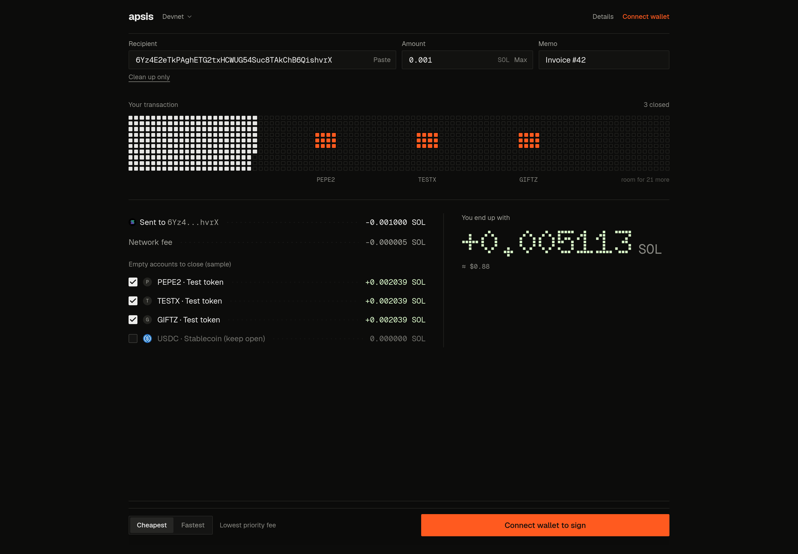
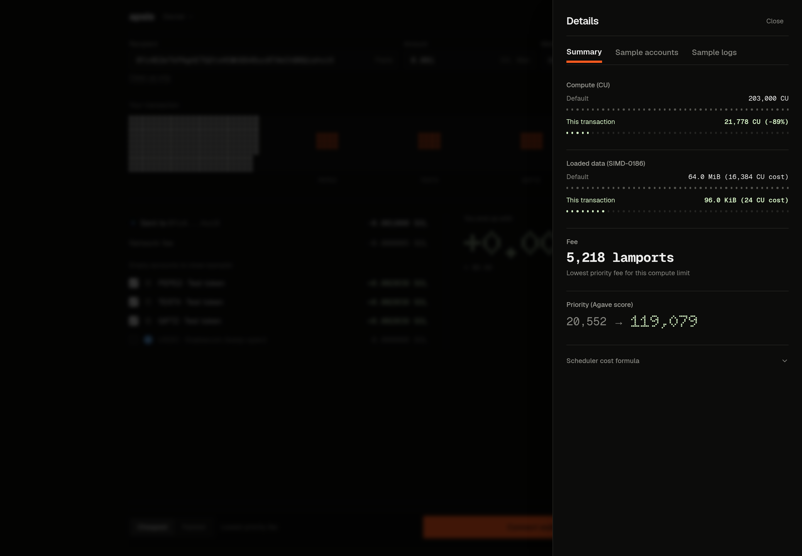
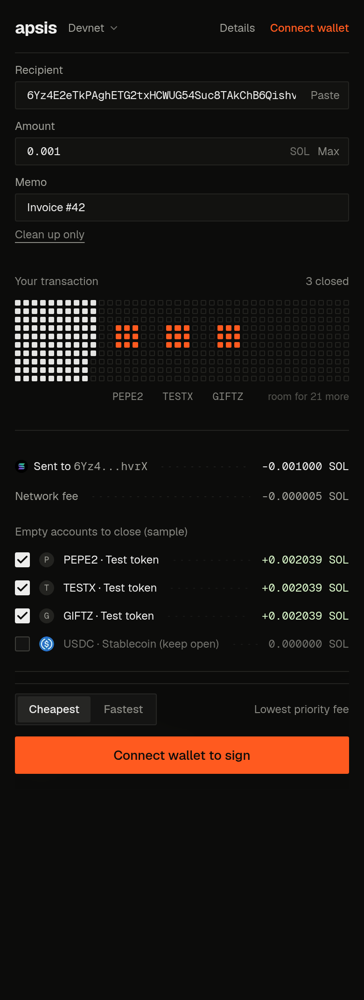

# apsis

Pay someone on Solana and recover the SOL locked in your empty token accounts, in the same transaction. Your balance can go up after you pay.

Built for the MLH Solana Hackathon (AI track, Best Use of Solana).



| Details drawer | Mobile |
| :--- | :--- |
|  |  |

---

## The problem

Every token a Solana wallet has ever held, including airdrops, test tokens and dead coins, leaves behind a 165-byte token account. Each one locks a refundable deposit of 0.00203928 SOL (2,039,280 lamports). When the token balance reaches zero the account stays open, and the deposit stays locked until someone sends a `CloseAccount` instruction.

Closing every empty account blindly is not safe either. An empty USDC account might be about to receive a payroll payment, and closing it makes the next sender pay to recreate it. Deciding which empty accounts are junk and which are expected to be used again is the hard part.

## What apsis does

You enter a payment: recipient, amount and a memo. Before you sign, apsis does three things.

1. **Check.** It simulates the payment on Devnet. If the simulation fails, signing is disabled, so you cannot sign a transaction that would fail.
2. **Trim.** It reads what the simulation actually used and sets the compute limit to that amount plus a 10% margin, instead of the 203,000 default. It also sets the loaded-accounts data limit from the real account sizes instead of the 64 MiB default. This lowers the fee for the same priority, or raises the priority for the same fee, depending on the mode you pick.
3. **Sweep.** It scans your wallet for token accounts with a zero balance (Token and Token-2022), asks TypeSafe's Jev model which are safe to close, and packs `CloseAccount` instructions for those into the unused space in the same transaction (up to 8, within Solana's 1,232-byte limit). It then simulates the final transaction again before you sign.

Example: send 0.001 SOL and close three empty accounts. The network fee is a few thousand lamports and the three accounts return about 0.0061 SOL, so your balance ends up about 0.005 SOL higher than before. You signed once.

The SOL you recover is your own deposit coming back. It is not yield.

## How the AI is used, and how it is limited

For each empty account, Jev (pinned to `jev-1.14.0`, through `@typesafe-ai/sdk`) answers two questions:

- What kind of token is this? One of `spam_airdrop`, `dead_or_test_token`, `stablecoin`, `major_asset` or `unknown`.
- How likely is it that the owner receives this token again soon? A probability from 0 to 1.

The model only proposes. Plain code decides. An account is selected for closing only if its kind is `spam_airdrop` or `dead_or_test_token` and the repeat-receipt probability is below 0.30. USDC and other known stablecoins are never selected automatically. You can override any account with its checkbox, and the final transaction is simulated again before signing.

If `TYPESAFE_API_KEY` is missing or the request fails, apsis switches to a rules-based fallback and labels the result as such. The fallback never shows made-up confidence scores.

## Try it

### Option A: one-click demo wallet

No browser extension and no faucet visit. Click **Try with demo wallet**. apsis creates a burner wallet in this browser, asks the server to send it 0.05 Devnet SOL from a funder key, then creates three empty test token accounts. Signing after that is a real Devnet transaction.

The funder key lives only in `DEMO_FUNDER_SECRET_KEY` on the server (a JSON array of keypair bytes). Generate one from the project folder:

```bash
node -e '
const { Keypair } = require("@solana/web3.js");
const fs = require("fs");
const kp = Keypair.generate();
fs.writeFileSync("funder.json", JSON.stringify(Array.from(kp.secretKey)));
console.log(kp.publicKey.toBase58());
'
```

The command prints the public address. Put the contents of `funder.json` in `.env.local` as `DEMO_FUNDER_SECRET_KEY`, fund that address with about 1 Devnet SOL at https://faucet.solana.com, and restart the dev server. `funder.json` is gitignored. Optional `DEMO_RPC_URL` overrides the Devnet RPC used for that transfer.

### Option B: preview without a wallet

Open the app. It loads four sample accounts (three disposable test accounts and one Devnet USDC account) and sends them through the same classification route as real accounts, so you see the full flow: the transaction grid, the ledger, the net result and the Details drawer.

The preview does not send anything on-chain. The base payment is simulated on Devnet with a stand-in account as the payer. Because the sample accounts do not exist on-chain, the account closes and the log lines shown for them in preview are illustrative. Connect a wallet to see real simulation results for real accounts.

### Option C: real transactions on Devnet

1. Connect Phantom, Solflare or Coinbase Wallet set to Devnet. If you have no wallet, choose the burner wallet. It is a throwaway Devnet keypair stored in your browser's local storage. Never put real funds in it.
2. Get Devnet SOL from the Devnet menu in the top bar, or from https://faucet.solana.com.
3. Create three empty test token accounts with "+ Seed 3 test empty accounts". It creates one reusable test mint and three empty accounts, locking about 0.0061 SOL.
4. Enter a recipient, an amount and a memo, then press **Sign and send**.
5. Open the transaction on Solscan from the confirmation. Your wallet's Devnet balance went up.

## Run locally

Requires Node.js 20 or newer.

```bash
npm install
cp .env.example .env.local
```

Open `.env.local` and set `TYPESAFE_API_KEY` if you want Jev classifications. Without it the app uses the rules-based fallback. For the one-click demo wallet, also set `DEMO_FUNDER_SECRET_KEY` as described under Try it. The Devnet RPC endpoint is changed in the app, from the Devnet menu.

```bash
npm run dev
```

Open http://localhost:3000. The repo's `.npmrc` sets `legacy-peer-deps=true`, so a plain `npm install` is enough.

If you deploy the app, set `TYPESAFE_API_KEY` in your host's environment settings, otherwise visitors only see the fallback.

## Modes

The **Cheapest / Fastest** switch changes how the savings are spent.

- **Cheapest** keeps the compute price the same, so the priority fee drops along with the smaller compute limit.
- **Fastest** keeps the original fee and raises the compute price, which raises the transaction's scheduler priority for the same cost.

The priority comparison is against an unoptimized transaction with the default compute limit and a reference price of 10,000 micro-lamports per compute unit. It is a comparison with that reference, not a claim about every real-world transaction.

## How it works

| Step | File | What it does |
| :--- | :--- | :--- |
| Check, Trim, Pack | `src/lib/compiler.ts` | Simulates, sets the compute and loaded-data limits, packs close instructions, re-simulates |
| Scan | `src/lib/zombies.ts` | Finds zero-balance Token and Token-2022 accounts |
| Classify | `src/lib/jev.ts`, `src/app/api/ai/jev/route.ts` | Calls Jev from the server, applies the close policy, provides the rules-based fallback |
| Seed | `src/lib/seed.ts` | Creates Devnet test accounts for demos |
| Interface | `src/app/page.tsx`, `src/components/` | Transaction grid, ledger, net result, Details drawer |

The scheduler priority shown in the Details drawer uses the Agave cost model:

```
totalCost = signatures × 720 + writeLocks × 300 + ceil(instructionDataBytes / 32)
            + computeUnitLimit + ceil(loadedDataLimitBytes / 32768) × 8
reward    = ceil(computeUnitPrice × computeUnitLimit / 1,000,000) + floor(baseFee / 2)
priority  = floor(reward × 1,000,000 / (totalCost + 1))
```

The loaded-data limit uses the real size of each account in the transaction (account data plus 64 bytes of overhead), including the program data accounts of upgradeable programs, rounded up to 32 KiB pages.

## Stack

Next.js 16 (App Router), TypeScript, Tailwind CSS 4, `@solana/web3.js`, `@solana/spl-token`, Solana wallet adapter, `@typesafe-ai/sdk`, `motion`, Radix UI primitives, and the Doto typeface for the dot-matrix numerals.

## Limits to know about

- Devnet only. Mainnet has not been tested.
- One recipient per payment.
- In preview mode the closes and log lines are illustrative. Real results need a connected wallet.
- Closing an account is permanent for that account. If you are expecting a token again, keep its checkbox off.
- The burner wallet keeps its secret key in browser local storage. It is for Devnet testing only.
