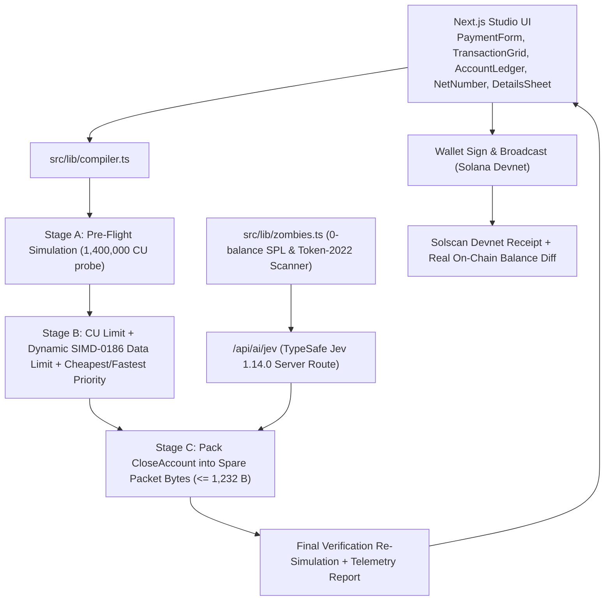

# `ap-sis` — *Pay and get paid back.*

> **Solana Pre-Flight Transaction Compiler & Negative-Gas Payment Engine powered by TypeSafe `Jev` (`jev-1.14.0`)**  
> Built for the **MLH Solana Hackathon**.

---

## 1. What is `ap-sis`?

Every time you interact with tokens, airdrops, or DeFi on Solana, your wallet accumulates **165-byte SPL Token accounts** that each lock **`0.00203928 SOL` (`2,039,280` lamports)** in rent-exempt deposit. Even after a token balance hits `0`, that deposit stays locked forever unless an explicit `CloseAccount` instruction is executed.

Meanwhile, a standard Solana payment + invoice memo uses only **~284–308 bytes** of Solana's **1,232-byte UDP packet limit**—leaving over **900 bytes of paid-for packet space unused**, while defaulting to **203,000 CU** (`SIMD-0170`) and **64 MiB** of loaded-account data (`SIMD-0186` = `16,384 CU` of scheduler cost).

**`ap-sis` is a 3-stage pre-flight transaction compiler:**
1. **Stage A — Pre-Flight Simulation Probe:** Simulates the payment with a `1,400,000 CU` ceiling (`sigVerify: false`, `replaceRecentBlockhash: true`) and blocks signing if any runtime error occurs.
2. **Stage B — Budget Right-Sizing (`SIMD-0170` & `SIMD-0186` + Honest Cost-Model Optimizer):**
   - Right-sizes `SetComputeUnitLimit` to `ceil(unitsConsumed × 1.10)`.
   - Dynamically computes `SetLoadedAccountsDataSizeLimit` from real on-chain account sizes (`data.length + 64` bytes per account + `BPFLoaderUpgradeab1e11111111111111111111111` `programdata` sizes), rounded up to `32 KiB` pages (`8 CU` per page instead of `16,384 CU`).
   - Offers two mathematically honest optimization modes based on the Agave scheduler priority formula:
     - **Cheapest Mode:** Keeps the CU price steady; priority fee drops proportionally (`~82–95%`) with the right-sized CU limit.
     - **Fastest Mode:** Keeps the original lamport fee budget and raises `SetComputeUnitPrice`, boosting Agave scheduler priority by **5×–8×** for the same spend.
3. **Stage C — Spare-Byte `CloseAccount` Packing (Guided by TypeSafe `Jev`):**
   - Scans the connected wallet for 0-balance SPL Token & Token-2022 accounts.
   - Uses **TypeSafe's `Jev` (`jev-1.14.0`)** decision model via `@typesafe-ai/sdk` (`choice` + `noul`) to classify which empty accounts are safe to close (`spam_airdrop` / `dead_or_test_token` with repeat-receipt probability `< 0.30`) vs. recurring payment tokens (`stablecoin` / `major_asset`).
   - Packs up to 8 `CloseAccount` instructions into the transaction's unused bytes (`≤ 1,232 B`) and re-simulates to verify.

**The Result:** When you send a `0.001 SOL` invoice payment while closing 3 zombie accounts (`+0.00611784 SOL` reclaimed rent), your wallet balance goes **UP by `+0.005112 SOL`** in the same atomic transaction.

> **Transparency by design:** Reclaimed SOL is **your own locked token-account deposit coming back**, not yield. And if `TYPESAFE_API_KEY` is offline or unreachable, `ap-sis` switches visibly to **Heuristic mode** without ever faking AI confidence scores.

---

## 2. Architecture



---

## 3. Exact Protocol Math

### Agave Scheduler Cost & Priority Formula
$$
\text{totalCost} = (N_{\text{sig}} \times 720) + (N_{\text{writeLocks}} \times 300) + \left\lceil \frac{\text{ixDataBytes}}{32} \right\rceil + \text{cuLimit} + \left(\left\lceil \frac{\text{dataLimitBytes}}{32{,}768} \right\rceil \times 8\right)
$$

$$
\text{reward} = \left\lceil \frac{\text{cuPrice}_{\mu\text{L}} \times \text{cuLimit}}{10^6} \right\rceil + \left\lfloor \frac{\text{baseFee}}{2} \right\rfloor, \qquad \text{Priority} = \left\lfloor \frac{\text{reward} \times 10^6}{\text{totalCost} + 1} \right\rfloor
$$

### TypeSafe `Jev` (`@typesafe-ai/sdk`) Decision Schema
- **Call 1 — Batched Zombie Account Classifier:**
  - `acct_${i}_kind`: `choice(...)` over `{ spam_airdrop, dead_or_test_token, stablecoin, major_asset, unknown }`
  - `acct_${i}_receive_again`: `noul(...)` probability (`0..1`) that the wallet owner will receive the token again soon.
  - **Deterministic Code Policy:** Auto-select for closure if and only if `token_kind ∈ {spam_airdrop, dead_or_test_token}` **and** `will_receive_again < 0.30` (and not on the stablecoin allow-list). Users can override any account via checkboxes.
- **Call 2 — Intent Router & Pre-Sign Advisory Check:**
  - `intent`: `choice(...)` over `{ pay_with_memo, split_payment, cleanup_only, unsupported }`
  - `is_safe_to_sign`: `noul(...)` evaluating the simulation logs and balance-diff summary (advisory badge; never overrides a failed simulation).

---

## 4. Quick Start (Local Development)

1. **Install dependencies:**
   ```bash
   npm install
   ```
2. **Configure `.env.local`:**
   ```bash
   cp .env.example .env.local
   # Fill in your TypeSafe API key in .env.local
   ```
   *(If omitted, the app runs in explicit **Heuristic mode**.)*
3. **Start the development server:**
   ```bash
   npm run dev
   ```
   Open `http://localhost:3000`.

### Testing on Solana Devnet
- **No Wallet Connected (Instant Preview):**
  - On load, `ap-sis` runs a live Stage A → B → C pre-flight simulation against Solana Devnet and displays real `SIMD-0186` account data sizes and Agave priority telemetry.
  - Candidate accounts are classified live via `/api/ai/jev`.
- **With a Connected Devnet Wallet (Phantom / Solflare / Burner on Devnet):**
  1. Connect your wallet (switched to **Solana Devnet** in wallet settings).
  2. Click **`+1.0 Devnet SOL`** in the `[Devnet]` network popover (or use `https://faucet.solana.com` if the public RPC rate-limits).
  3. Click **`+ Seed 3 test empty accounts`** — creates one reusable Devnet test mint (cached in `localStorage` so mint rent is never wasted twice) and 3 empty 165-byte keypair token accounts (`0.00611784 SOL` total reclaimable deposit).
  4. Click **`Sign, send & reclaim`** on the `0.001 SOL` invoice payment preset.
  5. Inspect the **Confirmed Solscan Devnet Receipt** showing your real wallet SOL balance went **up by `+0.00511 SOL`** when you paid!
